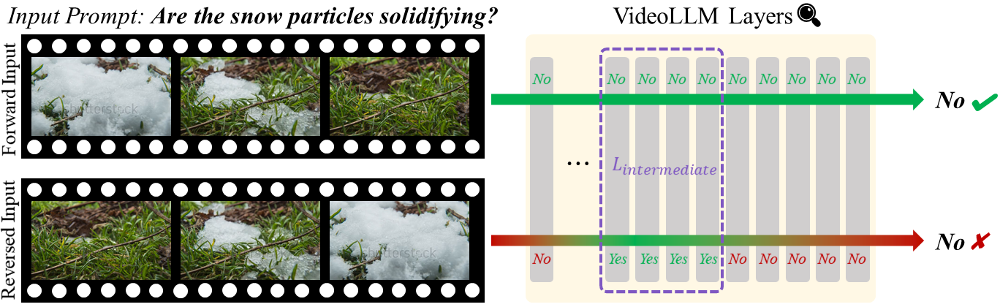
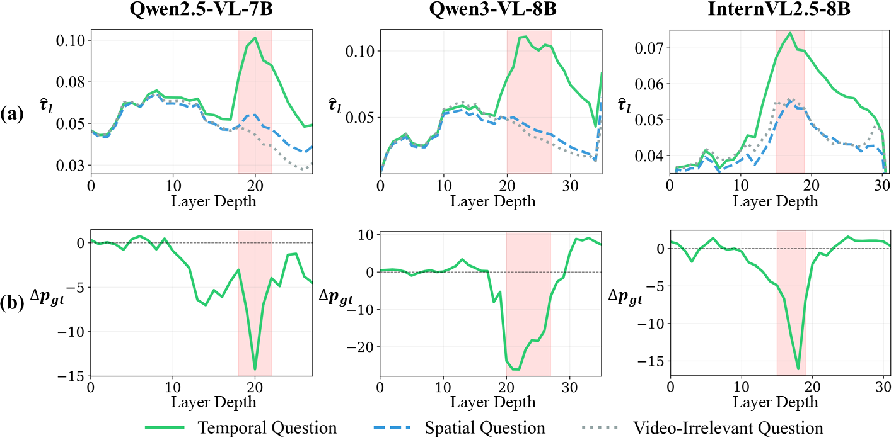
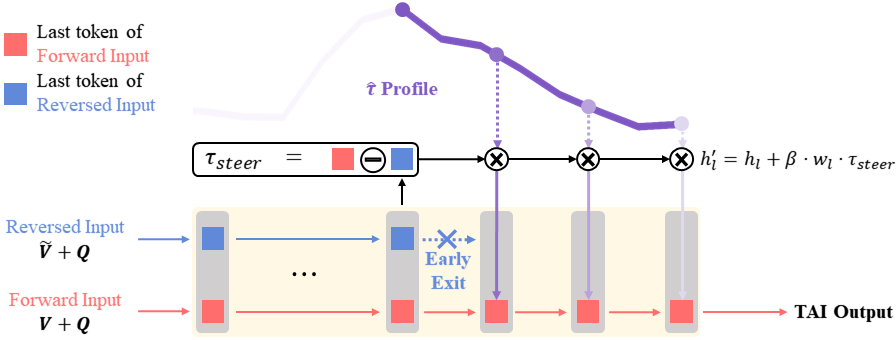

# Before It Fades: Reinforcing Temporal Representations at Inference Time in VideoLLMs

<div align="center">

[](https://arxiv.org/abs/2610.01595)&nbsp;

</div>

<p align="center">

</p>

<p align="center">
<i><b>The temporal answer is there, then it fades.</b> Reversing the video should flip the answer to
Yes. The intermediate layers get it right, but the prediction falls back to No before the output.</i>
</p>

<br>

## 📣 Update Logs

- Oct 2, 2026: 🚀 Code released!

- Oct 1, 2026: 📄 Paper release

- Sep 25, 2026: 🎉 Before It Fades has been accepted to NeurIPS 2026. 🎉

## 📝 Abstract

Video Large Language Models (VideoLLMs) receive frames in sequential order and interpret how visual
content evolves along the temporal axis, yet temporal reasoning remains a persistent weakness across
architectures. Reversing the frame order of a video, a transformation that should invert temporal
answers, often leaves the final prediction unchanged. We investigate where this failure originates by
defining the temporal divergence vector $\tau_l$, the layer-wise representational difference induced
by reversing temporal order. Tracking its magnitude across layers reveals a consistent temporal
divergence profile where the divergence peaks at intermediate layers and progressively diminishes
toward the output. We confirm this peak is specific to temporal reasoning and functionally critical
for predictions, establishing that VideoLLMs acquire temporal information at intermediate layers but
fail to maintain it to the output. This progressive fading motivates our method, Temporal Activation
Injection (TAI), which extracts $\tau_l$ at the peak of the profile for each input and reinjects it
into subsequent layers following the measured decay. TAI requires no training and consistently
improves temporal reasoning across three VideoLLMs and four benchmarks with negligible impact on
non-temporal tasks.

### 🔍 Temporal Information Peaks, Then Fades

<p align="center">

</p>

**Temporal divergence profile** 📈: $\hat\tau_l$, the gap between the forward and the reversed video at
layer $l$, peaks at intermediate layers for temporal questions only, and not for spatial or
video-irrelevant ones **(a)**.

**Functionally critical** 🎯: blocking the last token from attending to the preceding positions drops
the probability of the correct answer the most at the peak layers **(b)**.

### 💡 Temporal Activation Injection (TAI): Reinforce It Before It Fades

<p align="center">

</p>

**Extract** ✂️: the reversed input runs only up to the source layer at the peak of the profile and
exits early. $\tau_{steer}$ is the difference between the last tokens of the forward and the reversed
input there.

**Inject** 💉: every later layer adds $\tau_{steer}$, weighted by the measured decay of the profile,
$h_l' = h_l + \beta \cdot w_l \cdot \tau_{steer}$. No training, a single forward pass on the original
video.

## 🧩 Supported Models

Model families currently auto-detected from the model name: **Qwen-VL, InternVL, Molmo2, Gemma4**.
Any checkpoint from these families (HF hub id or local path) works out of the box, and other
architectures can be supported by extending `detect_family` / `prepare_input` in
[tai/tai_core.py](tai/tai_core.py).

## 🛠️ Installation

```bash
git clone https://github.com/Youngwoo-git/Before-It-Fades.git
cd Before-It-Fades
pip install -r requirements.txt
```

`flash-attn` is optional but recommended (Qwen/InternVL are loaded with
`attn_implementation="flash_attention_2"`).

## ⚡ Quick Start

Open [tutorial.ipynb](tutorial.ipynb): profile extraction, model loading, and a
baseline-vs-TAI comparison on your own video in four short steps
(Qwen2.5-VL-7B is used as the running example).

## 📦 Data Setup

- [TempCompass](https://github.com/llyx97/TempCompass) · [AoTBench](https://huggingface.co/datasets/sherryxzh/AoTBench) · [TVBench](https://huggingface.co/datasets/FunAILab/TVBench) · [MVBench](https://huggingface.co/datasets/OpenGVLab/MVBench)

Point `DATA_ROOT` at your dataset root and source the helper, which derives `$TC_V`,
`$TC_D`, `$TC_QA`, `$AOT`, `$TV`, `$MV`:

```bash
export DATA_ROOT=/path/to/datasets
source scripts/bench_helpers.sh && bench_paths_check
```

τ profile extraction uses the **temporally reversed** direction videos that ship
with TempCompass (`<name>_reverse.mp4`, next to the originals). To extract a
profile from another dataset, create the reversed copies yourself and save them
the same way:

```bash
ffmpeg -i video.mp4 -vf reverse video_reverse.mp4
```

<details>
<summary><b>Profile extraction sample</b>: expected TempCompass layout &amp; QA format</summary>

```
TempCompass/
├── videos/
│   ├── 1034419625.mp4
│   ├── 1034419625_reverse.mp4     # reversed clip (included in TempCompass)
│   └── ...
├── yes_no.json
├── caption_matching.json
└── multi-choice.json
```

`yes_no.json` maps each video id to per-category QA lists. Profile extraction only
uses the `"direction"` entries and pairs `<id>` with `<id>_reverse`:

```json
{
  "1034419625": {
    "action": [ ... ],
    "direction": [
      {"question": "Is the man moving from left to right?", "answer": "yes"},
      {"question": "In the camera's point of view, is the man moving from left to right?", "answer": "yes"}
    ]
  },
  "1034419625_reverse": {
    "direction": [
      {"question": "Is the man moving from right to left?", "answer": "yes"}
    ]
  }
}
```

</details>

## 🚀 Usage

### 1. Extract a τ profile

One command per model:

```bash
python tau_profile/tau_norm_multi_model.py \
    --video_dir $TC_V --qa_json $TC_QA \
    --model_name $MODEL \
    --max_pairs 50 --n_frames 16 --output_dir tau_norm_16f
```

This writes `tau_norm_<model>.json` (+ plots) and prints the per-layer τ peak. The
JSON is consumed by the eval scripts via `--tau_profile`, which sets the source
layer to the peak and starts injection at the next layer automatically.

### 2. Run evaluations

Two methods: `--method baseline` and `--method tai`. β (injection strength) is chosen
once per model via a TempCompass sweep and transferred to the other benchmarks:

```bash
export MODEL=...      # e.g. Qwen/Qwen2.5-VL-7B-Instruct
export PROFILE=tau_norm_16f/tau_norm_<model>.json
export BETA=...       # from your TempCompass sweep
```

<details>
<summary><b>Per-benchmark commands</b>: TempCompass / TVBench / MVBench / AoTBench</summary>

#### TempCompass

```bash
# baseline
python evaluations/eval_tempcompass.py --video_dir $TC_V --data_dir $TC_D \
    --model_name $MODEL --method baseline --n_frames 16
```

```bash
# TAI (τ-guided; src layer auto-selected from the profile peak)
python evaluations/eval_tempcompass.py --video_dir $TC_V --data_dir $TC_D \
    --model_name $MODEL --method tai \
    --tau_profile $PROFILE --beta $BETA --n_frames 16
```

#### TVBench

```bash
python evaluations/eval_tvbench.py --tvbench_dir $TV \
    --model_name $MODEL --method tai \
    --tau_profile $PROFILE --beta $BETA --n_frames 16
```

#### MVBench

```bash
python evaluations/eval_mvbench.py --mvbench_dir $MV \
    --model_name $MODEL --method tai \
    --tau_profile $PROFILE --beta $BETA --n_frames 16
```

#### AoTBench

5 tasks, one json each:

```bash
for j in $AOT_JSONS; do
  python evaluations/eval_aotbench.py --json_path $AOT/data_files/${j}.json --video_dir $AOT \
      --model_name $MODEL --method tai \
      --tau_profile $PROFILE --beta $BETA --n_frames 16
done
```

</details>

### 3. Chaining benchmarks

`bench_chain` from `scripts/bench_helpers.sh` runs several benchmarks back-to-back
(`--skip_existing` makes re-runs safe):

```bash
bench_chain $MODEL 16 "tc aot tv"                                       # baseline
bench_chain $MODEL 16 "tc aot tv" --tau_profile $PROFILE --beta $BETA   # TAI
```

Results are written as JSON under each `--output_dir`. See the header of
[tai/tai_core.py](tai/tai_core.py) for the full argument reference.

## 📖 Citation

If this project provided insights or was helpful to your research, please give us a star ⭐ and cite us using:

```bibtex
@misc{shin2026arxiv,
      title={Before It Fades: Reinforcing Temporal Representations at Inference Time in VideoLLMs},
      author={Youngwoo Shin and Yusung Ro and Minseo Kim and Junmo Kim},
      year={2026},
      eprint={2610.01595},
      archivePrefix={arXiv},
      primaryClass={cs.CV},
      url={https://arxiv.org/abs/2610.01595},
}

@inproceedings{shin2026before,
  title={Before It Fades: Reinforcing Temporal Representations at Inference Time in Video{LLM}s},
  author={Youngwoo Shin and Yusung Ro and Minseo Kim and Junmo Kim},
  booktitle={The Fortieth Annual Conference on Neural Information Processing Systems},
  year={2026}
}
```

## License

This project is licensed under the MIT License - see the [LICENSE](./LICENSE) file for details.
